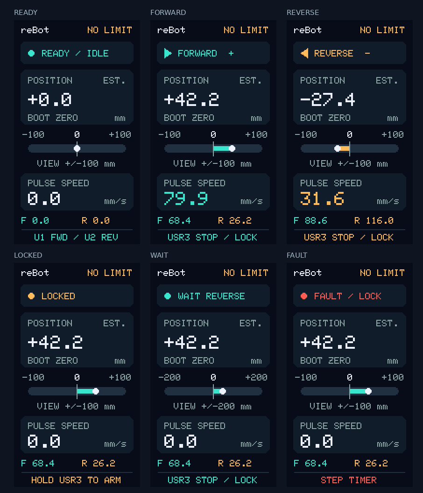

# XIAO 1.14 inch IPS Display (ESP32-S3)

屏幕板型号：Seeed Studio XIAO 1.14'' IPS Display (ESP32-S3)。
主控型号：XIAO ESP32-S3 Plus；LCD：ST7789，135 × 240，无触摸。

## 程序目录

- `xiao_pulse_trial/`：原 S3 单板点动程序，也保留两板点动固件复用的显示、计数和运控代码。
- `panel_s3_jog/`：双板点动的屏幕端程序，使用原仪表盘和三个按键，电机与 C3 相连。运行方法见 [C3 双板点动说明](../XIAO_ESP32C3/README.md)。
- `xiao_button_check/`：屏幕与按键诊断程序。
- `panel_s3_diagnostic/`：屏幕端 USB 诊断固件，使用 `PANEL_S3` 身份与 PC 握手，按 USR1 查询 C3 诊断状态。
- `tools/`：显示库大小写修复、USB 控制时序检查工具。
- `tests/`：点动状态逻辑的主机回归测试。

2026-11-18 从原项目 firmware 目录复制并校验。后续以本目录程序为准，在此维护。
原单板点动程序配置为 20 Hz 起步、最高 6827 Hz、2 秒升速、按住运行、松开停止，方向反相开启。按 3200 脉冲/转和 37.5 mm/转计算约 80 mm/s，实际速度需测量。

2026-11-20 双板 `panel_s3_jog` 已更新为协议 2，与新版 C3 和 PC 转发器配套。普通点动恢复 20 Hz 起步、2 秒升到 6827 Hz、按住持续运行（估算 80 mm/s）；限位退离单独限制为最高 200 Hz、累计最多 400 脉冲或 3 秒。C3 D4 为负向限位、D5 为原点、D10 为正向限位，输入由 C3 就地处理。屏幕改为显示 `LIMITS`、三路触发状态 `N/H/P`、退离提示和 `NOT HOMED`；下文 `NO LIMIT`、F/R 显示行及 S3 电机接线描述适用于保留的原单板 `xiao_pulse_trial`。双板屏幕固件将 D11/D12/D13 配置为输入，电机接在 C3 上。

## 当前现场版本（2026-11-23，协议 4）

两板与 PC 已配套更新到协议 4。自动寻零指令和双方向键长按入口已暂时禁用，锁定时仅提示 HOLD USR3 TO ARM。普通点动约 80 mm/s 配置不变。

任一端部触发后整轴停止锁定，显示 NEG END STOP / POS END STOP；只需一次长按 USR3 确认并松开，即进入受限低速反向退出；D4 负端显示 ESCAPE: U1 FWD，D10 正端显示 ESCAPE: U2 REV。限位稳定解除且已有反向脉冲后结束退离、重新加速，无需先松方向键；未解除时仍受退离预算保护。端部停机、确认和链路锁定保留坐标参考，位置不会因此跳变。D5 在经过原点时更新零点参考而不停止运动，显示 ORIGIN ZERO。`H:1` 是当前原点输入，`zeroed` 是经过原点校准的参考，`homed` 是自动寻零结果，三者不混用。详细规则见 [C3 当前现场版本](../XIAO_ESP32C3/README.md)。

## 历史双板版本（协议 3）

`panel_s3_jog`、C3 和 PC 转发统一升级到协议 3；须两板配套烧录后启动新版转发器。源码及离线逻辑验证完成，尚未烧录本次版本或完成实物回零测试。

屏幕支持具体故障原因、故障确认提示、原点输入状态、回零阶段、成功后的 HOMED ZERO 和独立参考位置。故障、锁定、松键提示优先显示，退离说明不再覆盖解锁操作。

USR3 在正常运行时停止并锁定；在输入故障且两端解除时，长按约 1 秒确认故障，松手后保持锁定，必须另行长按解锁。锁定时同时长按 USR1+USR2，看到 RELEASE FOR HOME 后松开，启动独立低速回零；回零中任意按键会取消。回零过程和预算见 [C3 当前版本说明](../XIAO_ESP32C3/README.md)。

普通点动仍为 20 -> 6827 Hz / 2 秒、按住运行，目标速度约 80 mm/s。回零低速参数独立配置。后续历史 UI 和原 S3 单板说明不代表当前双板功能。

## 仪表盘 UI

135 × 240 竖屏，深色背景、青色正向、琥珀色反向、红色故障。采用 16-bit 离屏缓冲（64,800 字节）绘制后整帧传输，常规刷新调度间隔至少 100 ms，实际速度受绘制和传输耗时影响，状态变化优先更新。控制任务仍独立于显示任务。

- `POSITION / EST.`：以本次 XIAO 上电/复位后第一次运动前的位置为 0，显示 STEP 脉冲推算的净位移，单位 mm。USR1 正向增加，USR2 反向减少。
- 双向位置条：0 位于中间，右侧为正、左侧为负；青色/琥珀色填充和白色游标表示当前位置。
- `VIEW +/-100 mm`：初始显示范围为 ±100 mm；超出后依次扩大为 ±200、±400、±800 mm 等，返回时保持已扩展刻度。这只是显示窗口，不代表可用行程或软限位。
- `PULSE SPEED`：按约 100 ms 窗口内实际软件计数的 STEP 上升沿换算速度，单位 mm/s；停止发脉冲时显示 0。它不是编码器测得的机械速度，低速时可能因计数分辨率轻微跳动。
- `F` / `R`：本次上电以来正向/反向各自累计路程，单位 mm；往返运动不会相互抵消。净位移为 F 减 R。
- 顶部状态：正转、反转、启动/换向等待、就绪、锁定、松键提示和故障；底部按状态显示按键操作提示或故障原因。`NO LIMIT` 保留无限位提醒。

停止、锁定、重新解锁和换向均不清除位置与累计路程。XIAO 重新上电/复位后清零，不恢复上次位置，也不自动回零。外力推动、同步带打滑、驱动未跟随等不会被当前计数检测到；显示值不能代替滑台位置反馈。换算常量集中在 `xiao_pulse_trial/MotionTelemetry.h` 的 `MM_PER_PULSE`，当前为 `37.5 / 3200`。

UI 版本已通过 ESP32-S3 Plus 编译与主机回归。用户确认驱动 24 V 已关闭后完成烧录与写入校验；8 秒 USB 启动采集确认 LOCKED、零脉冲、位置/速度为 0、timer=OK、fault=NONE，控制循环最大间隔 1 ms，界面单帧绘制约 140–141 ms。记录保存在 `.build/ui-initial-status.log`。这是断开 24 V、锁定状态下的观测，屏幕外观和带电运动验收仍待用户确认。原有运动策略与 STEP 定时器波形实现未修改。

软件绘制预览（示例数据，不是实机照片）：



## 接线

- EN：D11 / GPIO38。
- STEP：D12 / GPIO39。
- DIR：D13 / GPIO40。
- USR1 / USR2 / USR3：正向 / 反向 / 软件停止与解锁。

上电锁定；长按 USR3 约 1 秒并松开全部按键后解锁。当前没有端部限位输入；USR3 为软件停止。

## 双 USB 串口诊断

屏幕端使用 `panel_s3_diagnostic`，C3 使用 `axis_c3_diagnostic`。保持驱动器 24 V 关闭，两块板各通过 USB 数据线接到 Linux PC。屏幕固件将原电机信号脚 D11、D12、D13 设为输入。诊断模式显示 C3 的锁定状态以及两端限位、原点的原始电平。

PC 串口测试先通过 `HELLO` 识别两块板，再触发一次「S3 请求 → PC → C3 `STATUS` → PC → S3 显示」。测试脚本可在任意目录执行。传入两个串口路径时顺序不限。`--listen 30` 会继续等待屏幕上的 USR1 按键，按下后执行同样的查询。

```bash
python3 /home/seeed/reBot_line/tools/check_panel_axis_usb.py --listen 30
```

2026-11-19 已编译并烧录 `PANEL_S3`，写入校验通过。PC 用两个串口顺序分别运行往返测试，均正确识别两块板。C3 回报 `LOCKED`、零生成脉冲和原始电平 `L:1 R:1 H:1`，S3 确认提交显示帧。

## 构建

本机已使用 Arduino-ESP32 3.3.12、Seeed_GFX2 v1.0.0。
开发板选择 XIAO_ESP32S3_Plus；USBMode=hwcdc、CDCOnBoot=default、PSRAM=opi。

以下命令在本型号目录内执行：

```bash
python3 tools/fix_seeed_gfx_case.py /home/seeed/Arduino/libraries/Seeed_GFX2

/home/seeed/.local/bin/arduino-cli compile \
  --fqbn esp32:esp32:XIAO_ESP32S3_Plus \
  --board-options USBMode=hwcdc,CDCOnBoot=default,PSRAM=opi \
  --build-path .build/xiao_pulse_trial \
  --warnings default --jobs 4 xiao_pulse_trial
```

上传前关闭驱动器 24 V 电源，并核对实际 USB 端口：

```bash
/home/seeed/.local/bin/arduino-cli upload \
  --fqbn esp32:esp32:XIAO_ESP32S3_Plus \
  --board-options USBMode=hwcdc,CDCOnBoot=default,PSRAM=opi \
  --port /dev/ttyACM0 --input-dir .build/xiao_pulse_trial \
  xiao_pulse_trial
```

主机逻辑测试：

```bash
mkdir -p .build/tests
g++ -std=c++17 -Wall -Wextra -Werror tests/jog_trial_test.cpp -o .build/tests/jog_trial_test
.build/tests/jog_trial_test

g++ -std=c++17 -Wall -Wextra -Werror tests/motion_telemetry_test.cpp -o .build/tests/motion_telemetry_test
.build/tests/motion_telemetry_test

g++ -std=c++17 -Wall -Wextra -Werror tests/dashboard_preview.cpp -o .build/tests/dashboard_preview
.build/tests/dashboard_preview .build/ui-preview
```

重新生成预览（Python 需要 Pillow，读取本机 Seeed_GFX2 的 GLCD 字体）：

```bash
python3 -m venv .build/preview-env
.build/preview-env/bin/pip install Pillow
.build/preview-env/bin/python tools/render_dashboard_preview.py
```

原项目备份位置：
`/home/seeed/文档/ChatGPT/rebot production line/firmware`。
